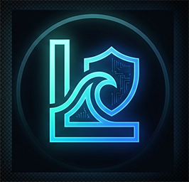
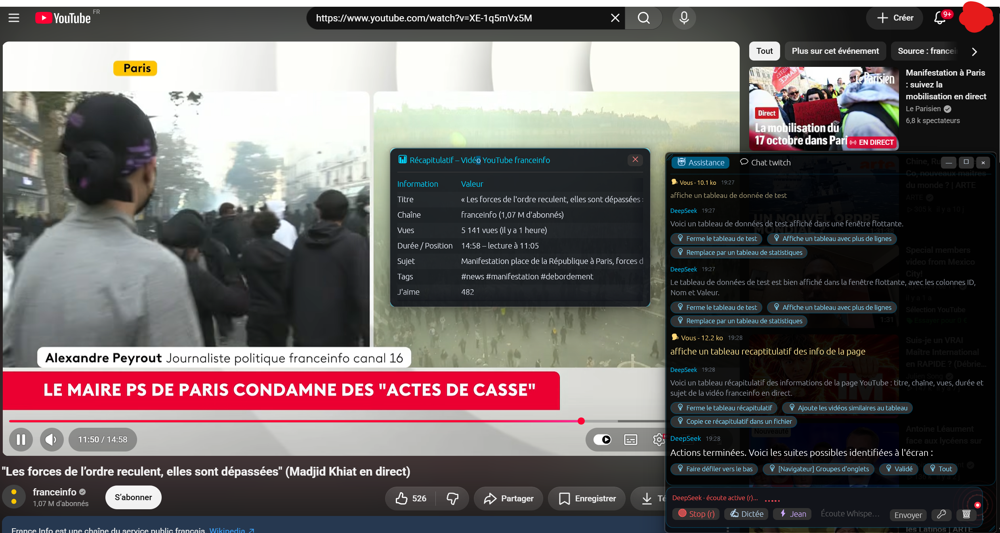

#  Libertide

Windows : [](https://github.com/anonympins/libertide/actions/workflows/rust.yml) / UNIX : [](https://github.com/anonympins/libertide/actions/workflows/rust-unix.yml)

[](https://github.com/anonympins/libertide/releases)
[](https://github.com/anonympins/libertide/blob/main/LICENSE)
[](https://github.com/anonympins/libertide)

<p align="center">
  
</p>

Libertide is a voice and visual assistant for autonomous exploration on Windows and Unix / Linux (X11). It combines a discreet transparent overlay interface (developed with [egui](https://github.com/emilk/egui)), continuous local voice recognition with **Whisper**, reasoning from the **DeepSeek-Chat** model, as well as graphical interface automation (Windows UI Automation & X11 EWMH tools, window tiling, web navigation, and input).

---

## 📋 Prerequisites

1. **Operating System**:
   - **Windows**: Windows 10 / 11 (64-bit).
   - **Unix / Linux**: Any modern distribution running an X11 / Xorg desktop session (Ubuntu, Debian, Fedora, Arch Linux, etc.).
2. **Microphone and speakers**: For Whisper dictation and voice feedback (via Windows SAPI or Unix `spd-say` / `espeak-ng`).
3. **DeepSeek API Key**: Obtain it from the [DeepSeek Platform](https://platform.deepseek.com/). Data consumption : 5-10ko per input message, and very low on output messages.

Go to [the current release](https://github.com/anonympins/libertide/releases) and select the executable for your operating system.

---

## 🎙️ Whisper Voice Model

On the first launch of voice listening:
- Libertide checks for the presence of the `models/ggml-base.bin` or `models/ggml-tiny.bin` model.
- If absent, the application automatically downloads it from Hugging Face (approximately 148 MB) into the `models/` subfolder.

---

## ⌨️ Usage and Shortcuts

| Shortcut / Action | Description |
| :--- | :--- |
| **`R` key** | Starts or stops instant Whisper voice capture. |
| **`Escape` key** | **Emergency stop**: exits dictation mode or halts any ongoing action, mutes TTS, and immediately gives control back to the user. |
| **Enter** | Sends the instruction entered in the text field. |
| **Dragging** | Click and drag the top banner or the bottom bar to anchor the overlay wherever you want. |
| **Borders & Corners** | Resize the overlay by stretching the edges and corners. |
| **Assistance tab** | Tracks the dialogue with DeepSeek, automated actions, and clickable quick suggestions. |
| **Chat tab** | Connection and monitoring of a Twitch channel with an integrated search bar. |

---

## 🗣️ Commands Understood by the AI (Human-Friendly Guide)

Libertide understands natural language instructions spoken aloud (via Whisper) or typed into the prompt bar. Below are the primary categories of commands you can give the assistant:

### 1. Overlay Control & Emergency Stop
- **Hide overlay**: *"Hide yourself"* / *"Cache-toi"*, *"Close overlay"* / *"Ferme l'overlay"*, *"Disappear"*
- **Restore overlay**: *"DeepSeek open up"* / *"DeepSeek ouvre-toi"*, *"Show yourself"* / *"Montre-toi"*
- **Immediate emergency stop**: Press **`Escape`** or say *"Stop everything"*, *"Stop"*

### 2. ✍️ Direct Voice Dictation Mode
Switches directly to text input inside whatever window currently has focus (text editor, IDE, form) without triggering exploratory web or system actions:
- **Enable**: *"Dictation mode"* / *"Mode dictée"*, *"Take notes on what I say"* (or click the `✍ Dictée` button).
- **Stop**: Press **`Escape`**, or say *"Stop dictation"* / *"Arrête la dictée"*, *"Exit dictation"*, *"I'm done"*.
- **Formatting & Caret Navigation while dictating**:
  - *"New line"* / *"À la ligne"*, *"Next line"*, *"New paragraph"*
  - *"Cursor left"* / *"Curseur à gauche"*, *"Cursor right"*, *"Up"*, *"Down"*
  - *"Start of line"* / *"Début de ligne"*, *"End of line"*, *"Start of document"*, *"End of document"*
  - *"Delete word"* / *"Efface le mot"*, *"Delete line"* / *"Efface la ligne"*, *"Select all"* / *"Tout sélectionner"*

### 3. 🌐 Web Browsing, Search & Shopping
- **Search / Navigation**:
  - *"Open Google and search for the best noise cancelling headphones"*
  - *"Go to wikipedia.org"*
  - *"Open youtube.com in a new tab"*
- **Interactions & Obstacles**:
  - *"Click 'Accept all'"* (the agent detects and clicks cookie consent dialogs and GDPR banners automatically)
  - *"Click the first result"*
  - *"Scroll down"* / *"Fais défiler vers le bas"*, *"Scroll to the top"*
- **Assisted Shopping**:
  - *"Add the item to the cart and proceed to checkout"* (Libertide will automatically stop before payment and ask for spoken confirmation).

### 4. 🪟 Window Management & Layouts
- **Snap & Tiling Layouts**:
  - *"Put Chrome on the left and VS Code on the right"*
  - *"Tile my windows"* / *"Arrange in a 2x2 grid"*
  - *"Fullscreen"* / *"Maximize this window"*, *"Minimize window"*
  - *"Close the tab"* (closes only the current active tab without terminating the whole application)

### 5. 💻 Code, File & Terminal Inspection
- **Inspect & Summarize code or documents**:
  - *"Read the file opened in VS Code and explain what the main function does"*
  - *"Analyze what is inside my terminal"*
  - *"Select between 'Hello' and 'Best regards'"* (bounded text selection)

### 6. 🧘 Immersion Mode (Virtual Desktop)
Creates a clean, dedicated Windows virtual desktop configured for focused deep work:
- **Start**: *"Activate immersion mode to code"* (spawns a new virtual desktop, opens required applications such as VS Code, a terminal, and docs tiled together)
- **Exit**: *"Exit immersion mode"* / *"Close the virtual desktop"*

### 7. ⚙️ Windows Startup (Autostart)
- **Enable auto-launch**: *"Start when Windows boots"*, *"Enable autostart"*
- **Disable auto-launch**: *"Do not start on boot"*, *"Disable autostart"*
- **Check status**: *"Are you configured to start on boot?"*

### 8. ⚡ Direct CLI Execution
Prefix your prompt with `>` or `$` to instantly run a system command without invoking the LLM:
```bash
> code .
> calc.exe
$ git status
```

---

## 🛠️ Troubleshooting

- **Error `DEEPSEEK_API_KEY in the .env file`**: Verify that the `.env` file is correctly placed at the project root without a hidden `.txt` extension.
- **C++ / Whisper compilation error**: Make sure you have launched Cargo from the *x64 Native Tools Command Prompt for VS* terminal or that the MSVC compiler is accessible in your `PATH`.
- **Microphone inactive**: Verify that microphone access is authorized for desktop applications in Windows privacy settings.