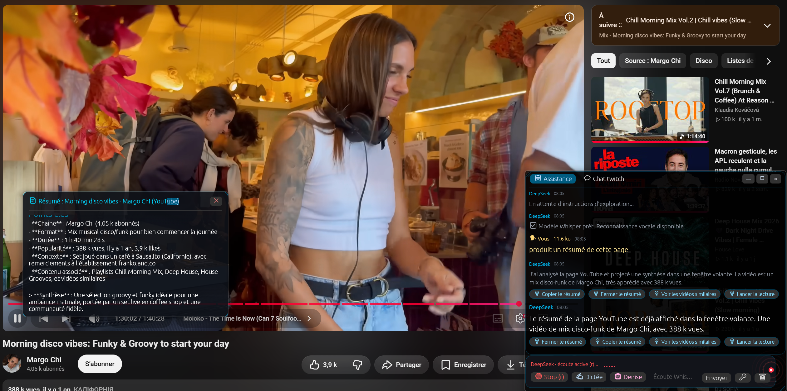
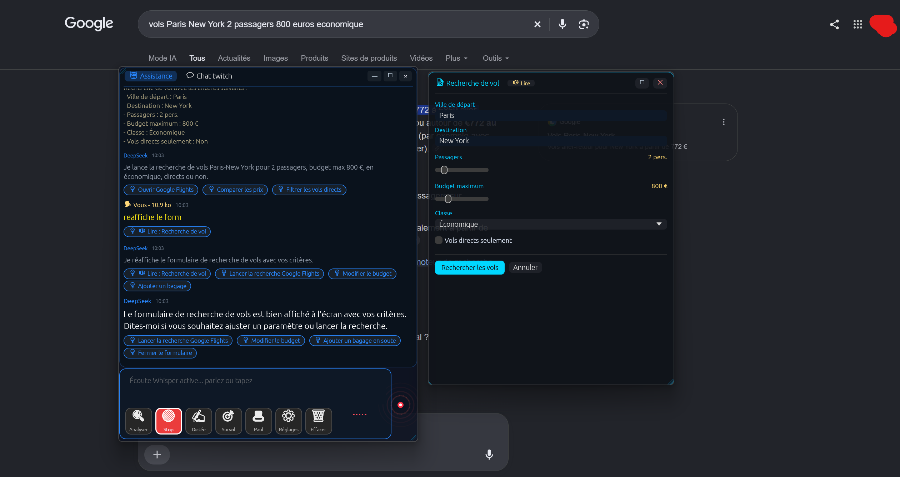

#  Libertide
> **Empowering everyone to use their computer with complete freedom and autonomy.**  
> Libertide is a lightweight, high-performance assistive desktop overlay combining intelligent voice control, anti-tremor hover navigation, click-by-number badges, and single-switch access to eliminate physical barriers without requiring expensive proprietary hardware.

[](https://github.com/anonympins/libertide/releases)
[](https://github.com/anonympins/libertide/blob/main/LICENSE)
[](#-visual-comfort--high-visibility-wcag-aaa)
[](#-getting-started-in-3-steps)

[](https://github.com/anonympins/libertide/actions/workflows/rust.yml)
[](https://github.com/anonympins/libertide/actions/workflows/rust-unix.yml)
[](https://github.com/anonympins/libertide/actions/workflows/rust-macos.yml)

<p align="center">
  
  
  
</p>

---

## 💡 Why Libertide? (The Autonomy Challenge)

Modern operating systems and websites require **surgical precision**: fast double-clicks, targeting tiny close buttons, dismissing invasive cookie banners, and holding complex key combinations.

For millions of people, these ordinary interactions become an exhausting hurdle, causing pain or digital exclusion:

- **Tremors and motor impairments** (*Parkinson's disease, essential tremor, ataxia*): clicking small targets triggers accidental clicks or frustrating misses.
- **Severely limited mobility or paralysis** (*Tetraplegia, ALS / Lou Gehrig's disease, muscular dystrophies*): standard mouse or keyboard usage is difficult or impossible.
- **Chronic pain and temporary injuries** (*RSI, acute tendonitis, carpal tunnel syndrome, cast on a limb*): every mouse movement exacerbates discomfort.
- **Low vision and eye fatigue** (*AMD, low vision, light sensitivity*): difficulty locating the cursor or reading low-contrast gray text.
- **Cognitive overload and attention disorders**: difficulty navigating pages cluttered with ads and intricate dropdown menus.

> **The Libertide promise:** You no longer need to adapt to the computer. The computer adapts to your abilities, your rhythm, and your movements.

---

## 🛡️ The Solution: Compassionate Technology

Libertide runs as a **transparent, unobtrusive assistive overlay** displayed above your existing desktop apps (Word, web browsers, emails, file explorers). It combines several core innovations:

### 1. 🎯 Stabilized Hover & Click-by-Number Targeting
Eliminates precision aiming fatigue and accidental clicks caused by tremors:
- **High-Visibility Gold Badges**: When Hover / Target mode is engaged, prominent high-contrast numbered badges are placed directly over buttons, links, inputs, and tabs.
- **Anti-Tremor Stabilization (Dwell & Pause)**: Move the pointer near any target. Once still for 200&nbsp;ms, Libertide locks on, outlines the element in contrasting cyan or orange, and reads its name and purpose aloud.
- **Effortless Direct Activation**:
  - **Keypad / Numpad**: Type the badge number directly. A 900&nbsp;ms debounce automatically confirms and clicks, or press `Enter`/`Space` immediately.
  - **Voice**: Speak the badge number (*"3"*, *"twelve"*, or *"click 5"*).
  - **Pointer Dwell**: Keep the pointer still over the target to auto-trigger (configurable 0–2500&nbsp;ms dwell delay).
- **Stable Badge Reconciliation**: An intelligent reconciliation engine preserves badge numbers across dynamic screen updates and small scrolling adjustments, preventing confusing badge renumbering.

### 2. 🔘 Hierarchical Single-Switch Access
Designed for users with single-movement abilities (micro-switch, puff-and-sip, single switch, or spacebar):
- **Cascading 3-Step Navigation**: Window Level ➔ Region/Zone Level ➔ Individual Control Level.
- **Semantic Summaries**: As each window or zone is selected, Libertide synthesizes what is inside so you know where you are without hunting visually.
- **Single-Button Control**: Short press selects/advances; long press (>1.1&nbsp;s) goes back or exits.

### 3. 🎙️ Private Local Dictation & Autonomous Agent
- **100% On-Device Dictation (Whisper)**: Speak letters, emails, or code naturally. Real-time speech transcription runs locally via `whisper.cpp`—voice data never leaves your computer.
- **Autonomous Multi-Pass Reasoning**: Powered by leading LLMs (DeepSeek, Claude, GPT-4o, Mistral, Groq), Libertide plans and chains multi-step actions (scrolling, clicking, tab management, web exploration) across multiple reasoning passes.
- **Safety & Undo Stack**: Every simulated interaction (keystrokes, tab opens, navigation) is recorded in an undo stack. Say *"Undo"* or press `Escape` to rollback.

### 4. 🪟 Interactive Floating Cards
Complex information is extracted and projected into accessible floating window cards:
- **Interactive Forms**: Flight searches, hotel finders, and filter tools rendered with high-contrast sliders, dropdowns, and checkboxes.
- **Comparison Tables**: Sortable product, travel, or specification tables with one-click copy and actionable links (`[link="action:..."]`).
- **Markdown Syntheses**: Clean article and document summaries with interactive action buttons.

### 5. 🛡️ Removal of Web Obstacles & Transaction Safety
- **Automatic Barrier Dismissal**: Automatically detects and dismisses invasive cookie consent banners and push notification prompts.
- **Protected Payment Guardrail**: The agent can search products, compare prices, and manage shopping carts, but **strictly stops before checkout/payment screens**, requiring explicit user confirmation.

### 6. 👁️ Universal OCR Fallback
- **Zero Accessibility Dead-Ends**: Works seamlessly on legacy software, Java Swing apps, canvas elements, games, or remote desktops where OS accessibility APIs (UIA, AX, AT-SPI) lack metadata.
- **Instant Actionability**: An embedded high-speed OCR engine detects textual and button areas, assigning them clickable badges and hover narrations.

### 7. 🎨 Visual Comfort & Custom Accessibility Themes (WCAG AAA)
The interface adapts dynamically to your eyesight:
- **Dynamic Zoom**: Say *"Zoom in"*, *"Enlarge text"*, or use UI buttons to scale from 70% to 250%.
- **Multilingual Accessibility**: Toggle effortlessly between French, English, or Automatic System Language via settings or by voice (*"Passer en anglais"*, *"Passer en français"*).
- **Specialized Profiles**:
  - *High-Contrast Yellow & Black* (WCAG AAA for low vision and macular degeneration).
  - *High-Contrast White & Black* (crisp, glare-free pure monochrome).
  - *Soft Amber* (blue-light reduction for photophobia and chronic headaches).
  - *Colorblind Friendly* (cobalt blue and gold contrast optimized for deuteranopia and protanopia).
  - *Cyber Cyan, Mint Emerald & Neon Purple*.
- **Earcons**: Distinct audio cues acknowledge mic status, actions, and emergency stops without visual feedback.

---

## 📖 Everyday Use Cases (Real-World Examples)

### ✉️ 1. Drafting an email or document without strain
1. Open your mail client or word processor.
2. Press `F8`, touch the auxiliary trackball button, or say *"Dictation mode"*.
3. Dictate your thoughts naturally:
   - *"Hello Doctor comma new line"*
   - *"I confirm our appointment next Tuesday period"*
4. Say *"Stop dictation"* or press `Escape`.

### 🌍 2. Browsing the web without struggling against the screen
- **Read without eye strain**: *"Summarize this article"*  
  ➔ Libertide inspects the web page and displays a clear summary card in large, readable typography.
- **Target and click links**: Press `F7` or say *"Hover mode"*:
  ➔ Golden numbered badges overlay every clickable link and control.
  ➔ Speak *"Click 4"* or type `4` on the numeric keypad to open it.

### 🖱️ 3. Clicking without shaking
- **With gaze or mouse**: Point at the target area: Libertide outlines it and speaks the button label (*"Close window"*, *"Search"*), executing upon dwell timer expiration or single switch tap.

### 🪟 4. Organizing your workspace
- *"Put the browser on the left and my notes on the right"*  
  ➔ Windows snap edge-to-edge automatically.
- *"Mute sound"* / *"Louder"*.

### ⏱️ 5. Reminders and deferred commands
- *"Remind me to take my medication in 30 minutes"*
- *"In 10 minutes close the browser"*

---

## ⌨️ Essential Shortcuts

| Shortcut / Trigger | Action |
| :--- | :--- |
| **`F7`** / **Trackball Button 5** | Toggles Stabilized Hover & Click-by-Number badges. |
| **`F8`** / **`Pause/Break`** / **Trackball Button 4** | Starts or stops instant local speech dictation. |
| **`F9`** | Cycles natural speech voices (Denise, Henri, Hortense, Paul, Sylvie, Jean). |
| **`F4`** | Clears chat memory and window analysis cache. |
| **`Numpad 0-9`** / **Number Keys** | Directly selects and clicks the corresponding badge number (in Hover/Badge mode). |
| **`Backspace`** | Deletes the last entered digit in the number buffer; when empty, navigates back one step. |
| **`Spacebar`** / **`Enter`** | Confirms/clicks the focused badge or selected element; validates number buffer immediately. |
| **`Tab` / `Shift+Tab` / Arrow Keys** | Steps forward/backward through switch access targets or regions. |
| **`Middle Mouse Button`** | Instantly silences text-to-speech reading. |
| **`Escape`** | **Safety & Emergency Stop**: immediately aborts agent execution, silences voice, exits dictation, or navigates back one step. |

---

## 🚀 Getting Started in 3 Steps

### Step 1: Download Libertide
Download the binary built for your OS from the Releases page:
- **Windows** (`.exe`): Windows 10 & 11 (64-bit).
- **macOS**: Apple Silicon (M1/M2/M3/M4) or Intel.
- **Linux**: Ubuntu, Debian, Fedora, Arch (X11 / Wayland).

### Step 2: Plug in your existing devices
Libertide requires no specialized hardware:
- Built-in microphone or any USB headset.
- Any standard mouse, trackball, trackpad, eye-tracker, or adaptive switch.

### Step 3: Configure your AI provider
To process natural language commands, configure your preferred LLM provider:
1. Launch the application.
2. Click the **⚙ Settings** button in the lower bar (or say *"API Key"*).
3. Choose your provider (**DeepSeek**, **OpenAI**, **Anthropic**, **Mistral**, **Groq**, or **GLM**) and paste your key.

*(On the first speech-recognition session, the lightweight local Whisper model downloads automatically in the background).*

---

## 🛠️ Building from Source

Libertide is built natively in **Rust** using `eframe` (`egui`):

### Prerequisites
- [Rust](https://rustup.rs/) (latest stable toolchain)
- C/C++ compiler (`MSVC` on Windows, `clang` on macOS, `gcc` on Linux)
- *Linux only:* `libasound2-dev`, `libx11-dev`, `libxtst-dev`, `python3-gi` (for AT-SPI)

### Build Steps
```bash
# Clone repository
git clone https://github.com/anonympins/libertide.git
cd libertide

# Run in development mode
cargo run --release
```

---

## 🤝 For Caregivers, Families, and Occupational Therapists

If you are assisting someone with diminishing autonomy, Libertide provides vital design guarantees:

- **Zero vendor lock-in**: users keep their favorite software, web browsers, and routines. Libertide doesn't replace their environment; it makes it accessible.
- **Adapts over time**: start with simple stabilized hover, introduce voice dictation, and transition to single-switch access whenever condition changes dictate.
- **Zero proprietary subscriptions required**: Libertide is completely free and open-source.
- **Safety first**: pressing `Escape` instantly returns full manual control to the user or caregiver.

---

## 🗣️ Core Voice Commands Guide

Libertide understands English, French, and most modern languages:

| Category | What you can say out loud |
| :--- | :--- |
| **Interface Control** | *"Hide"* • *"Show up"* • *"Emergency stop"* • *"Stop"* |
| **Pointing & Clicking Help** | *"Hover mode"* • *"Numbers"* / *"Badges"* • *"Click 3"* • *"Switch mode"* |
| **Display & Themes** | *"Zoom in"* • *"Zoom out"* • *"Reset zoom"* • *"High contrast"* • *"Next theme"* • *"Passer en anglais / français"* |
| **Dictation & Writing** | *"Dictation mode"* • *"New line"* • *"Delete word"* • *"Stop dictation"* |
| **Reading & Summaries** | *"Summarize this page"* • *"What is this video about?"* • *"Read this text"* |
| **Workspace & Comfort** | *"Tile windows side by side"* • *"Mute sound"* • *"Close tab"* |
| **Reminders & Timers** | *"Remind me to take my medicine in 20 minutes"* |

---

## ❓ Frequently Asked Questions (FAQ)

**Does Libertide work without expensive assistive hardware?**  
Yes, absolutely. That is the core mission: a standard webcam, any basic microphone, and a regular mouse or keyboard spacebar are all you need.

**How does Libertide handle apps without native accessibility tags (canvas, legacy tools)?**  
Libertide includes an embedded OCR engine that scans visual screen regions in real time. Visual labels and controls in custom apps or remote desktops are automatically recognized, read aloud, and assigned click badges.

**Do my voice and private data remain private?**  
Speech recognition for continuous dictation runs directly on your local machine via Whisper. Your speech is not sent to external servers for continuous transcription.

**Can I use Libertide at school or at work?**  
Yes. Libertide acts as a non-intrusive transparent desktop overlay without modifying core operating system files or requiring elevated administrative rights for daily tasks.

---

<p align="center">
  <b>Libertide — Crafted with passion for autonomy and digital inclusion for all.</b><br>
  Distributed under a free, open-source license.
</p>