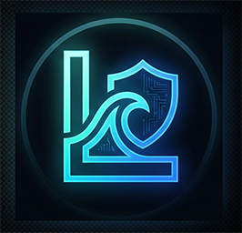

#  Libertide
> **Empowering everyone to use their computer with complete freedom and autonomy.**  
> Libertide is a lightweight, high-performance assistive desktop overlay combining intelligent voice control, AI webcam & hardware eye-tracking with magnetic snapping, anti-tremor hover navigation, click-by-number badges, wireless single-switch access, virtual predictive keyboard, and local smart-home automation to eliminate physical barriers without requiring expensive proprietary hardware.

[](https://github.com/anonympins/libertide/releases)
[](https://github.com/anonympins/libertide/blob/main/LICENSE)
[](#-visual-comfort--high-visibility-wcag-aaa)
[](#-getting-started-in-3-steps)


[](https://github.com/anonympins/libertide/actions/workflows/rust-windows.yml)
[](https://github.com/anonympins/libertide/actions/workflows/rust-unix.yml)
[](https://github.com/anonympins/libertide/actions/workflows/rust-macos.yml)

<p align="center">
  
  
  
  
</p>

**VIDEO :**

[](https://youtu.be/Ozan2FyBZRI)

---

## 💡 Why Libertide? (The Autonomy Challenge)

Modern operating systems and websites require **surgical precision**: fast double-clicks, targeting tiny close buttons, dismissing invasive cookie banners, and holding complex key combinations.

For millions of people, these ordinary interactions become an exhausting hurdle, causing pain or digital exclusion:

- **Tremors and motor impairments** (*Parkinson's disease, essential tremor, ataxia*): clicking small targets triggers accidental clicks or frustrating misses.
- **Severely limited mobility or paralysis** (*Tetraplegia, ALS / Lou Gehrig's disease, muscular dystrophies*): standard mouse or keyboard usage is difficult or impossible.
- **Chronic pain and temporary injuries** (*RSI, acute tendonitis, carpal tunnel syndrome, cast on a limb*): every mouse movement exacerbates discomfort.
- **Low vision and eye fatigue** (*AMD, low vision, light sensitivity*): difficulty locating the cursor or reading low-contrast gray text.
- **Cognitive overload and attention disorders**: difficulty navigating pages cluttered with ads and intricate dropdown menus.

> **The Libertide promise:** You no longer need to adapt to the computer. The computer adapts to your abilities, your rhythm, and your movements.

---

## 🛡️ The Solution: Compassionate Technology

Libertide runs as a **transparent, unobtrusive assistive overlay** displayed above your existing desktop apps (Word, web browsers, emails, file explorers). It combines several core innovations:

### 1. 🎯 Shake-Free Aiming & Clicking (Numbered Badges & Stabilizer)
- **For Everyone:** No need for millimeter-level accuracy on tiny buttons! Large golden numbered badges appear over every clickable element. Simply speak the badge number (*"click 4"*), type the number on your keyboard, or dwell over it briefly to trigger a click.
- **For Caregivers & Occupational Therapists:** Eliminates dysmetria and physical strain for individuals with intention tremors, ataxia, or Parkinson's disease. Features an anti-tremor stabilizer (configurable dwell timer from 0 to 2500 ms with debounce filtering) and dynamic badge reconciliation to prevent disruptive renumbering while scrolling.

### 2. 👁️ Full Gaze Control (Webcam AI Eye-Tracking & Dedicated Hardware)
- **For Everyone:** Your gaze becomes a magic mouse! Look at a button, and the cursor is magnetically attracted to it.
- **For Caregivers & Occupational Therapists:** Complete solution for tetraplegia, locked-in syndrome (ALS), or advanced muscular dystrophies:
  - **No Costly Hardware Needed:** Works with a standard computer webcam powered by an embedded local neural network (L2CS-Net ONNX, ~2.6 MB).
  - **Medical Hardware Compatible:** Connects directly via universal OpenGaze (TCP 4242) and OpenTrack (UDP 4242) protocols for Tobii bars, GazePoint GP3, or Pupil Labs.
  - **Physiological Filtering:** Employs a *1€ (One Euro)* filter to smooth involuntary nystagmus and micro-saccades, paired with selective hysteresis magnetism to lock onto targets without erratic jumps.

### 3. 🔘 Universal 1-Button Access (Single-Switch & Wireless Gateway)
- **For Everyone:** A single physical movement controls everything! A short press moves forward, while a long press steps back.
- **For Caregivers & Occupational Therapists:** Designed for individuals with minimal residual motor capability (*sip-and-puff* breath switches, eye blinks, muscle twitches, mechanical micro-switches).
  - **Hierarchical Pyramidal Scanning:** Window ➔ Region ➔ Individual Button, with synthetic speech feedback for each zone to prevent visual exploration fatigue.
  - **Free Wireless Gateway:** Instantly turns any smartphone, tablet, or inexpensive ESP32 board into a dedicated remote switch (local WebSocket/HTTP/UDP server) featuring haptic vibration feedback.

### 4. ⌨️ Accessible Virtual Keyboard & AAC Communication
- **For Everyone:** An on-screen keyboard that predicts words before you finish typing, reading your sentences aloud.
- **For Caregivers & Speech Therapists:** Accessible virtual keyboard supporting automatic scanning (row/column auto-scan), eye gaze, or single-switch control. Includes multilingual predictive dictionaries (9 languages) and an AAC (Augmentative and Alternative Communication) module to instantly voice essential daily needs at home or in hospital environments.

### 5. 🎙️ 100% Private Voice Dictation & AI Companion (Zero Cloud)
- **For Everyone:** Dictate emails, assignments, or documents effortlessly. Ask questions to your computer, and it responds with empathy and clarity.
- **For Caregivers & Healthcare Institutions:** **Strict medical confidentiality (GDPR / Medical privacy)**:
  - Continuous speech dictation (Whisper) and local language models (Llama 3, Qwen 2.5) run **entirely offline on your machine**; no voice recordings or health-related data ever leave the device.
  - On-device vision AI (Qwen2-VL) can interpret legacy enterprise software, HTML5 canvas elements, or custom controls lacking accessibility labels.
  - Safety safeguards: instant emergency stop via the `Escape` key or the voice command *"Stop"*.

### 6. 🏠 Bedroom Autonomy & Smart Home (Hospital Bed, Lights, Blinds)
- **For Everyone:** Control your room using your voice or gaze: turn off lights, close blinds, or adjust the thermostat without moving.
- **For Caregivers & Occupational Therapists:** Substantially lowers caregiver reliance for routine comfort tasks:
  - **Controls motorized hospital beds** (*backrest elevation, flat inclination*) and patient room surroundings.
  - Direct local communication without Internet dependency: compatible with Home Assistant (WebSocket), KNXnet/IP gateways (native UDP cEMI telegrams), and hospital building automation systems (BACnet/IP).
  - 1-Click Care Presets: *Sleep Mode* (bed laid flat, blinds closed, lights off, session locked) and *Meal/Work Mode*.

### 7. 🪟 Simplified Floating Cards & Real-Time Live Subtitles
- **For Everyone:** Dense online content (long articles, schedules, weather) is transformed into clean summary cards in large typography. Videos and virtual meetings are captioned in real time.
- **For Caregivers & Speech Therapists:** Relieves cognitive load for patients with brain injuries, post-stroke conditions, or attention deficit disorders (ADHD). Loopback audio capture instantly transcribes spoken audio for deaf and hard-of-hearing users with an accompanying audio spectrum visualizer.

### 8. ⏰ Health Reminders, Timers & Proactive Wellness
- **For Everyone:** Simply say: *"Remind me to drink a glass of water in 20 minutes"* or *"Timer 5 minutes"*.
- **For Caregivers:** Programmable medication and hydration schedule manager (one-time natural language reminders or recurring `@hourly` crons). Background wellness companion that suggests posture adjustments, hydration, and muscle relaxation without interrupting active typing.

### 9. 🎵 Accessible Music & Anti-Spasticity Drum Machine
- **For Everyone:** Create music, drum grooves, and playful synthesizer tones using a single switch or your gaze.
- **For Occupational Therapists & Music Therapists:** Motor rehabilitation and leisure engagement tool. The 8 sound pads are quantized to a 4/4 rhythm with a morphing filter that prevents accidental burst triggers caused by spasticity or tremors.

### 10. 🛡️ Friction Shield & Payment Transaction Safeguard
- **For Everyone:** Libertide automatically bypasses intrusive cookie banners so you can browse peacefully.
- **For Families & Legal Guardians:** Impenetrable financial shield: the assistant can help assemble an online shopping cart, but **strictly halts execution before any payment or checkout page**, requiring manual verification and explicit consent from the user or caregiver.

### 11. 🎨 High-Visibility Visual Comfort (WCAG AAA Compliance)
- **For Everyone:** Scale your display up to 250% by voice (*"Zoom in"*) and select the color palette that is gentlest on your eyes.
- **For Ophthalmologists & Orthoptists:** Compliant with the most rigorous accessibility standards:
  - Profiles tailored to eye conditions: *High-Visibility Yellow & Black* (AMD, low vision), *Soft Amber* (photophobia, chronic headaches), *High Contrast Glare-Free*, and color blindness profiles (protanopia, deuteranopia).
  - **Binaural 3D Audio:** Acoustic feedback originates spatially from the exact screen coordinates of the targeted control, reinforcing auditory spatial orientation.

---

## 📖 Everyday Use Cases (Real-World Examples)

### ✉️ 1. Drafting an email or document without strain
1. Open your mail client or word processor.
2. Press `F8`, touch the auxiliary trackball button, or say *"Dictation mode"*.
3. Dictate your thoughts naturally:
   - *"Hello Doctor comma new line"*
   - *"I confirm our appointment next Tuesday period"*
4. Say *"Stop dictation"* or press `Escape`.

### 🌍 2. Browsing the web without struggling against the screen
- **Read without eye strain**: *"Summarize this article"*  
  ➔ Libertide inspects the web page and displays a clear summary card in large, readable typography.
- **Target and click links**: Press `F7` or say *"Hover mode"*:
  ➔ Golden numbered badges overlay every clickable link and control.
  ➔ Speak *"Click 4"* or type `4` on the numeric keypad to open it.

### 👁️ 3. Hands-free control with Eye Tracking & Dwell
- Turn on Eye Tracking: point with your gaze towards any control or link.
  ➔ Libertide magnetizes the cursor directly onto the target, outlines it, and auto-triggers via dwell timer without requiring any physical hands or switch click.

### 🖱️ 4. Clicking without shaking
- **With gaze or mouse**: Point at the target area: Libertide outlines it and speaks the button label (*"Close window"*, *"Search"*), executing upon dwell timer expiration or single switch tap.

### 🏠 5. Controlling your home and medical bed hands-free
- Say *"Turn on the living room light"* or *"Tilt the medical bed"*:
  ➔ Libertide dispatches the command locally over WebSocket or direct KNX UDP without passing through cloud services.

### ⌨️ 6. Writing with the adaptive virtual keyboard
- Say *"Virtual keyboard"* (or *"Clavier virtuel"*) or press the keyboard button:
  ➔ An accessible on-screen keyboard opens with auto-scanning, multilingual word prediction, and single-click voicing or document injection.

### 🪟 7. Organizing your workspace
- *"Put the browser on the left and my notes on the right"*  
  ➔ Windows snap edge-to-edge automatically.
- *"Mute sound"* / *"Louder"*.

### 📺 8. Live video and audio subtitles
- Say *"Start subtitles"* / *"Stop subtitles"*:
  ➔ Libertide captures system audio output in loopback and displays real-time subtitles in a high-contrast floating card accompanied by a live 16-band spectrum equalizer.

### ⏱️ 9. Reminders and deferred commands
- *"Remind me to take my medication in 30 minutes"*
- *"In 10 minutes close the browser"*
- *"Remind me to drink water every hour"* / *"Every 30m"*

### 📺 10. Twitch streams & Live Chat
- *"Open Twitch chat for kamet0"*
- Look at live status, viewer count and stream title, or click *"🌐 Join on Twitch"* to watch.

### 🌿 11. Proactive Companion wellness thoughts
- Say *"Enable thoughts"* / *"Disable thoughts"* to toggle gentle periodic wellness and posture check-ins.

---

## ⌨️ Essential Shortcuts

| Shortcut / Trigger | Action |
| :--- | :--- |
| **`F7`** / **Trackball Button 5** | Toggles Stabilized Hover & Click-by-Number badges *(customizable)*. |
| **`F8`** / **`Pause/Break`** / **Trackball Button 4** | Starts or stops instant local speech dictation *(customizable)*. |
| **`F9`** | Cycles natural speech voices (Denise, Henri, Hortense, Paul, Sylvie, Jean, Cloned) *(customizable)*. |
| **`F4`** | Clears chat memory and window analysis cache *(customizable)*. |
| **`Numpad 0-9`** / **Number Keys** | Directly selects and clicks the corresponding badge number (in Hover/Badge mode). |
| **`Backspace`** | Deletes the last entered digit in the number buffer; when empty, navigates back one step. |
| **`Spacebar`** / **`Enter`** | Confirms/clicks the focused badge or selected element; validates number buffer immediately. |
| **`Tab` / `Shift+Tab` / Arrow Keys** | Steps forward/backward through switch access targets or regions. |
| **`Middle Mouse Button`** | Instantly silences text-to-speech reading. |
| **`Escape`** | **Safety & Emergency Stop**: immediately aborts agent execution, exits eye-tracking calibration, silences voice, exits dictation, or navigates back one step. |
 
*(Note: all shortcuts can be rebound to any keyboard key in Settings > Keybindings or via the `.env` file).*

---

## 🚀 Getting Started in 3 Steps

### Step 1: Download Libertide
Download the binary built for your OS from the Releases page:
- **Windows** (`.exe`): Windows 10 & 11 (64-bit).
- **macOS**: Apple Silicon (M1/M2/M3/M4) or Intel.
- **Linux**: Ubuntu, Debian, Fedora, Arch (X11 / Wayland).

### Step 2: Plug in your existing devices
Libertide requires no specialized hardware:
- Built-in microphone or any USB headset.
- Any standard webcam (for AI gaze tracking), mouse, trackball, trackpad, eye-tracker (Tobii, GazePoint), or adaptive switch.

### Step 3: Configure your AI provider
To process natural language commands, configure your preferred LLM provider:
1. Launch the application.
2. Click the **⚙ Settings** button in the lower bar (or say *"API Key"*).
3. Choose your provider:
   - **Cloud Providers**: **DeepSeek**, **OpenAI**, **Anthropic**, **Mistral**, **Groq**, or **GLM** (paste your API key).
   - **100% Local & Free (Zero API Key)**: Choose **Local** and select your preferred on-device model from the presets:
     - *Qwen 2.5 1.5B Instruct* (~986 MB) [Default]
     - *Llama 3.2 1B Instruct* (~770 MB)
     - *Qwen 2.5 3B Instruct* (~1.9 GB)
     - *Llama 3.2 3B Instruct* (~2.0 GB)
     - *Qwen 2.5 7B Instruct* (~4.7 GB)
     - *Meta-Llama 3.1 8B Instruct* (~4.9 GB)  
     Click **⬇ Download** to download the model with real-time speed/progress monitoring and resume support.

*(On the first speech-recognition session, the lightweight local Whisper model downloads automatically in the background).*

---

## 🛠️ Building from Source

Libertide is built natively in **Rust** using `eframe` (`egui`):

### Prerequisites
- [Rust](https://rustup.rs/) (latest stable toolchain)
- C/C++ compiler (`MSVC` on Windows, `clang` on macOS, `gcc` on Linux)
- *Linux only:* `libasound2-dev`, `libx11-dev`, `libxtst-dev`, `python3-gi` (for AT-SPI)

### Build Steps
```bash
# Clone repository
git clone https://github.com/anonympins/libertide.git
cd libertide

# Run in development mode
cargo run --release

# Run with Vulkan GPU acceleration (Windows / Linux)
cargo run --release --features vulkan
```

---

## 🤝 For Caregivers, Families, and Occupational Therapists

If you are assisting someone with diminishing autonomy, Libertide provides vital design guarantees:

- **Zero vendor lock-in**: users keep their favorite software, web browsers, and routines. Libertide doesn't replace their environment; it makes it accessible.
- **Adapts over time**: start with simple stabilized hover, introduce voice dictation, and transition to single-switch access whenever condition changes dictate.
- **Zero proprietary subscriptions required**: Libertide is completely free and open-source.
- **Safety first**: pressing `Escape` instantly returns full manual control to the user or caregiver.

---

## 🗣️ Core Voice Commands Guide

Libertide understands English, French, and most modern languages:

| Category | What you can say out loud |
| :--- | :--- |
| **Interface Control** | *"Hide"* • *"Show up"* • *"Emergency stop"* • *"Stop"* |
| **Eye Tracking & Gaze** | *"Enable snapping"* • *"Disable snapping"* • *"Tare / Calibrate"* • *"Continuous mode"* |
| **Virtual Keyboard** | *"Virtual keyboard"* • *"Open keyboard"* • *"Keyboard mode"* |
| **Home Automation** | *"Turn on the light"* • *"Turn off living room"* • *"Open blinds"* • *"Set heating to 21 degrees"* • *"Raise the bed"* |
| **Instrument & Rhythm** | *"Drum machine"* • *"Music mode"* • *"Play music"* |
| **Window Focus** | *"Focus Chrome"* • *"Bring Notepad to front"* • *"Switch to VS Code"* |
| **Live Subtitles** | *"Start subtitles"* • *"Stop subtitles"* • *"Active les sous-titres"* |
| **Pointing & Clicking Help** | *"Hover mode"* • *"Numbers"* / *"Badges"* • *"Click 3"* • *"Switch mode"* |
| **Display & Themes** | *"Zoom in"* • *"Zoom out"* • *"Reset zoom"* • *"High contrast"* • *"Next theme"* • *"Switch to English / French / German / Spanish"* |
| **Dictation & Writing** | *"Dictation mode"* • *"New line"* • *"Delete word"* • *"Stop dictation"* |
| **Reading & Summaries** | *"Summarize this page"* • *"Analyze page"* • *"What is this video about?"* • *"Read this text"* |
| **Workspace & Comfort** | *"Tile windows side by side"* • *"Mute sound"* • *"Close tab"* |
| **Reminders & Cron** | *"Remind me to take my medicine in 20 minutes"* • *"Remind me every hour"* • *"Timer 5 minutes"* • *"Cancel reminders"* |
| **Proactive Wellness** | *"Enable thoughts"* • *"Disable thoughts"* |

---

## ❓ Frequently Asked Questions (FAQ)

**Does Libertide work without expensive assistive hardware?**  
Yes, absolutely. That is the core mission: a standard webcam, any basic microphone, and a regular mouse or keyboard spacebar are all you need.

**Can I use professional eye-trackers like Tobii or GazePoint?**  
Yes. While Libertide provides a full built-in neural gaze tracker using standard webcams (via L2CS-Net ONNX), it also natively connects over TCP/UDP to OpenGaze and OpenTrack protocols for high-frequency hardware trackers.

**How does Libertide handle apps without native accessibility tags (canvas, legacy tools)?**  
Libertide includes an embedded OCR engine that scans visual screen regions in real time. Visual labels and controls in custom apps or remote desktops are automatically recognized, read aloud, and assigned click badges.

**Do my voice and private data remain private?**  
Speech recognition for continuous dictation runs directly on your local machine via Whisper. Your speech is not sent to external servers for continuous transcription.

**Can I use Libertide at school or at work?**  
Yes. Libertide acts as a non-intrusive transparent desktop overlay without modifying core operating system files or requiring elevated administrative rights for daily tasks.

---

<p align="center">
  <b>Libertide — Crafted with passion for autonomy and digital inclusion for all.</b><br>
  Distributed under a free, open-source license.
</p>